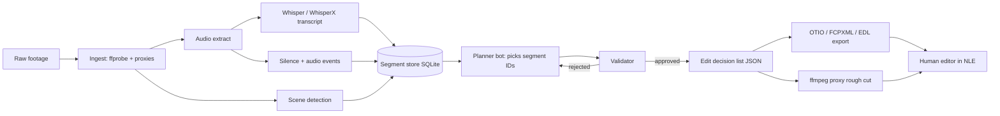

# Windy City Spook Sleuths — Video Media Editor
## Architecture (v0.1 draft)

Low-cost, local-first AI rough-cut editor for talking-head and paranormal-investigation footage.
Goal: turn hours of raw camera/audio into a reviewable rough cut and an NLE timeline, with the LLM
only making *decisions over text*, never touching pixels or inventing content.

---

## 1. Design principles

1. **Local-first.** Media never leaves the machine. Transcription, analysis, and rendering run locally.
2. **Deterministic tools do the heavy lifting.** ffmpeg, Whisper, and scripts do the work; the LLM only picks and orders segments.
3. **Text is the interface.** The LLM sees transcripts and metadata (small, cheap), never video frames by default.
4. **Every edit is grounded.** Every cut references real segment IDs and timestamps from the transcript. No ID, no cut.
5. **Non-destructive output.** Primary output is an editable timeline (EDL / FCPXML / OTIO) for a human editor, plus an optional proxy render.
6. **Small specialized bots.** Each bot has a narrow job, narrow context, and a strict output schema.

---

## 2. Components

| Layer | Component | Tooling (open source preferred) |
|---|---|---|
| Ingest | Media scanner, proxy generator | `ffprobe`, `ffmpeg` (low-res H.264 proxies) |
| Audio | Extraction + normalization | `ffmpeg` (16 kHz mono WAV, loudnorm) |
| Transcription | Word-level transcript | `whisper.cpp` or `faster-whisper`; WhisperX for word alignment |
| Diarization (optional) | Who is speaking | `pyannote.audio` |
| Signal analysis | Silence, scene changes, audio events | `ffmpeg silencedetect`, `scdet` / PySceneDetect; optional audio-event tagging for EVP / bangs |
| Segment store | Single source of truth | SQLite + JSON (segments, words, speakers, tags) |
| Edit planner | LLM picks/orders segments | Local LLM (Ollama / llama.cpp) by default, hosted model optional |
| Validator | Rejects ungrounded edits | Python schema + timestamp checks |
| Timeline export | Editable output | OpenTimelineIO → FCPXML (DaVinci Resolve / Premiere / FCP), CMX EDL |
| Render | Rough-cut preview | `ffmpeg` concat from proxies |
| Agent interface | Tool access for bots | MCP server exposing the operations above |
| Review UI (later) | Approve/reject cuts | Simple local web UI or text-based paper edit |

### MCP-driven editors (to evaluate, not yet chosen)
WeftCut, RoughCut, Frontstage, and Pireel are candidates. Before adopting any, check the license, whether it runs fully locally, what MCP tools it exposes, its export formats (OTIO/FCPXML), and whether it's still maintained.
Fallback: our own thin MCP server wrapping ffmpeg + OTIO (see §5), so we aren't locked into one of them.

---

## 3. Data flow



**Pipeline stages**
1. **Ingest.** Hash files, read metadata, and make proxies. Idempotent, so re-runs skip finished files.
2. **Transcribe.** Word-level timestamps, written once and cached by file hash.
3. **Analyze.** Silence, ums and filler, retakes, scene cuts, and audio spikes become tags on segments.
4. **Segment.** Split into sentence-level segments with stable IDs (`clip03_s0142`).
5. **Plan.** The planner gets a compact digest (ID, speaker, start/end, text, tags) and returns ordered IDs plus a reason.
6. **Validate.** IDs must exist, timestamps are taken from the store (never from the LLM), and there are no overlaps and no length violations.
7. **Export and render.** Timeline for the NLE plus a quick proxy MP4 for review.

---

## 4. Specialized bots (low tokens, low hallucination)

| Bot | Job | Sees | Outputs |
|---|---|---|---|
| **Video Editor Architect** | Architecture, tool choices, docs | Repo docs, research notes | Design docs, ADRs |
| **Spook Sleuths Video Researcher** | Evaluates open-source tools | Web, repos, licenses | Comparison notes |
| **Media Pipeline Coder** | Implements and maintains pipeline | Repo code | PRs, tests |
| **Cleanup bot** (runtime) | Removes filler, silence, false starts | One clip's segment digest | Segment IDs to drop |
| **Story planner bot** (runtime) | Orders an investigation narrative | Cleaned digest + outline/brief | Ordered segment IDs + reasons |
| **Highlight bot** (runtime) | Finds shorts and teaser moments | Digest + event tags | Up to N ID ranges |

**Why this keeps costs and hallucinations down**
- **Text only.** A 1-hour transcript is roughly 10–15k tokens, while frames would cost far more. Vision is used only on demand for specific tagged moments.
- **Compact digests.** Send IDs, short text, and tags, not raw Whisper JSON. Chunk long shoots per clip or scene.
- **IDs, not timestamps.** The LLM can only choose from existing IDs, and the validator resolves real times. Invented quotes or times are impossible by construction.
- **Strict JSON schemas** with an automatic reject-and-retry (max 2), then fall back to a human.
- **Cache everything** by file hash plus a prompt version. Re-planning doesn't re-transcribe.
- **Local model by default** (Ollama). Escalate to a hosted model only for the story-planning step if quality needs it.
- **Narrow context per bot.** Each runtime bot gets one job and one prompt file, and keeps no chat history.
- **Human checkpoint** before any final render, since the NLE timeline is the deliverable.

---

## 5. Internal MCP tool surface (proposed)

```
ingest_media(path)              -> media_id
transcribe(media_id, model)     -> transcript_id
analyze(media_id)               -> tags
list_segments(media_id, filter) -> compact digest
propose_edit(segment_ids[], notes) -> edl_id   # validated
export_timeline(edl_id, format) -> file path (fcpxml|edl|otio)
render_preview(edl_id)          -> mp4 path
```

---

## 6. Proposed repo layout

```
/docs            ARCHITECTURE.md, ADRs, tool evaluations
/pipeline
  ingest/        ffprobe, proxies
  transcribe/    whisper wrappers
  analyze/       silence, scenes, audio events
  store/         SQLite schema + access
  plan/          prompts/, schemas/, validator
  export/        OTIO, FCPXML, EDL
  render/        ffmpeg concat
/mcp_server      MCP tool surface (§5)
/prompts         versioned bot prompts
/tests           sample clips + golden outputs
config.yaml      models, paths, thresholds
```

---

## 7. Cost profile

| Item | Cost |
|---|---|
| ffmpeg, Whisper, OTIO, SQLite, PySceneDetect | Free / open source |
| Local LLM via Ollama | Free (your hardware) |
| Hosted LLM (optional, planning only) | Pay per token; text-only digests keep it small |
| GPU | Optional; whisper.cpp runs on CPU, a GPU speeds it up |

---

## 8. Roadmap

- **M1 — Transcribe and cut silence:** ingest, Whisper, silence removal, EDL export. No LLM.
- **M2 — Text-based paper edit:** a segment digest plus a human picking IDs leads to FCPXML/OTIO.
- **M3 — Cleanup bot:** filler, retakes, and false starts, with the validator.
- **M4 — Story planner + highlights:** investigation narrative, teaser picks.
- **M5 — MCP server + editor integration:** adopt or wrap the best of WeftCut/RoughCut/Frontstage/Pireel after evaluation.
- **M6 — Review UI** and audio-event tagging (EVP, knocks).

## 9. Open questions
- Target NLE: DaVinci Resolve, Premiere, or another?
- Hardware: GPU available?
- Typical footage: multicam? separate audio recorders (needs sync)?
- Local-only LLM, or hosted allowed for planning?
