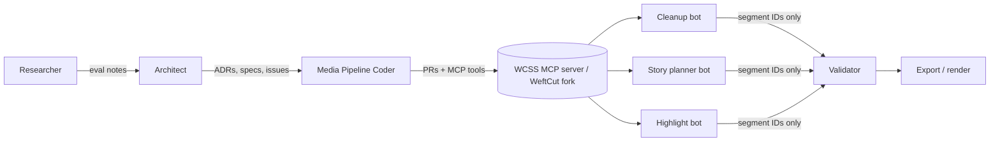

# Customization Roadmap — Forking WeftCut for Windy City Spook Sleuths

Status: v0.1 draft. Companion to `docs/ARCHITECTURE.md`.

> **Assumption check:** This plan assumes WeftCut is open source with a license that allows forking, runs locally, and exposes editing operations over MCP. Phase 0 verifies this. If any of it turns out to be false, we build these same features on our own thin MCP server (ARCHITECTURE.md §5), and the feature work below stays the same.

---

## Guiding rules

- **Keep the fork thin.** Put our features in separate modules or plugins and leave WeftCut's core alone wherever possible, so pulling in upstream updates stays easy.
- **Use deterministic tools first.** ffmpeg, Whisper, and DSP do the detection. LLM bots only choose from IDs that already exist.
- **Store presets as config.** Thresholds, caption styles, and export presets live in versioned YAML, not in code.
- **Everything has a test clip.** Each feature ships with a short sample and the output we expect.

---

## Phase 0 — Fork audit (week 1)

| Task | Owner bot | Output |
|---|---|---|
| Check license, maintenance activity, and local-only operation | Spook Sleuths Video Researcher | `docs/eval/weftcut.md` |
| Inventory the MCP tools WeftCut exposes and what they take and return | Researcher | Tool inventory table |
| Map where extensions plug in (plugins, hooks, export layer) | Media Pipeline Coder | `docs/eval/weftcut-extension-points.md` |
| Decide whether to fork, wrap, or build our own | Video Editor Architect | `docs/adr/0001-weftcut-fork.md` |
| Fork into the org, set an upstream remote, set up CI | Coder | Forked repo with passing CI |

**Exit criteria:** an approved decision record (ADR), a green CI build, and one sample clip that round-trips through the fork.

---

## Track A — Investigation tools

### A1. Silence and pause detection tuned for EVP sessions (Phase 1)
Investigation sessions are mostly quiet on purpose. A normal silence cutter would throw away the moments that matter most.
- **Two modes:**
  - `talking_head`: aggressive cuts (for example around −35 dB, longer than 0.6 s).
  - `evp_session`: **mark gaps but never cut them**. Uses a lower noise floor, longer minimum gaps, and keeps padding around question-then-pause patterns.
- **Adaptive noise floor:** measure each clip's room tone over its first N seconds and set thresholds relative to it.
- **Question windows:** when the transcript shows an investigator asking a question, protect the next X seconds (configurable) as a possible EVP response window.
- **Config:** `presets/silence/evp_session.yaml`, `talking_head.yaml`.
- **Tools:** ffmpeg `silencedetect`, `astats`, `loudnorm`. Optional denoise pass on a *copy* (`afftdn` / RNNoise), never the original.

### A2. Audio-event tagging (Phase 2)
- Detect transients and spikes (knocks, bangs), level jumps, and whisper-band energy inside quiet windows.
- Optional classifier (an open-source audio-event model, chosen in Phase 0 research) that labels events like speech, knock, footsteps, or door.
- Each event becomes a tag on a segment: `{id, start, end, type, confidence, source}`.
- **No claims:** tags say "possible audio event". The tool never labels anything paranormal. People decide that.
- Export events as **timeline markers** (FCPXML/OTIO markers) so they show up in Resolve or Premiere.

### A3. Transcript digests (Phase 1–2)
- A compact digest per clip: `segment_id | speaker | start-end | text (truncated) | tags`.
- Long sessions get a rolling summary: one line per 5-minute block, built from tags and text, not invented.
- Digests are the only thing runtime bots see, which caps token use per call.
- Output formats: `digest.md` for people and `digest.json` for bots.

### A4. Project templates for long investigation footage (Phase 2)
- `templates/investigation/` contains:
  - Folder layout: `cams/`, `audio_recorders/`, `stills/`, `notes/`.
  - Session metadata such as location, date, team, equipment, and session list.
  - Default presets: EVP silence mode, marker export, a review-first workflow.
  - **Multi-source sync:** line up separate recorders with the cameras by audio cross-correlation (plus a manual-offset fallback).
- One command: `wcss new-project --template investigation <name>`.

---

## Track B — Social media and Reels presets

### B1. 9:16 framing (Phase 3)
- Turn 16:9 footage into vertical 9:16 through a reframing step.
  - **Default:** face-tracked crop using an open-source face detector (for example MediaPipe or OpenCV DNN), smoothed so the crop doesn't jitter.
  - **Fallback:** fixed center crop, or a blurred-background letterbox for wide shots.
- Presets: `reels_9x16_1080x1920`, `square_1x1`, `landscape_16x9`.

### B2. Caption styles for Reels and TikTok (Phase 3)
- Word-level captions come straight from the Whisper word timestamps (no retyping, no LLM).
- Style presets stored as `.ass` subtitle templates: `spooky_bold`, `clean_minimal`, `karaoke_highlight`.
- Safe-zone aware: captions stay clear of the platform's UI areas. Margins are set per preset and checked against current platform guidelines in Phase 0 research.
- Burned in with ffmpeg `subtitles` / `ass`, plus an optional sidecar `.srt`.

### B3. Hook generation (Phase 4)
- The **Highlight bot** reads the digest plus event tags and proposes 3–5 hook candidates, each one an **existing segment range** with a one-line reason.
- Hook text overlays (an on-screen line for the first 1–3 s) may be written by the bot, but they're labeled as suggestions and need human approval. The bot never changes any quote from the transcript.
- Reusable hook formats ("Motifs") are stored as templates, for example a cold-open audio event, a question then silence, or a reaction shot. The bot picks a Motif and fills it with real segment IDs.

### B4. Batch export helpers (Phase 4)
- `wcss export --preset reels_9x16 --clips highlights.json` renders every approved clip.
- Each run produces a naming convention, a loudness target per platform, a thumbnail frame grab, and a CSV manifest (clip, duration, hook text, file path).
- A render queue that can resume after a failure. Uses GPU encoding when available, with CPU x264 as the fallback.

---

## Phased milestones

| Phase | Weeks | Scope | Exit criteria |
|---|---|---|---|
| 0 | 1 | Fork audit + ADR | ADR approved, CI green |
| 1 | 2–3 | A1 silence modes + A3 digests | EVP clip keeps all question windows; digest generated |
| 2 | 4–5 | A2 event tags + A4 templates + sync | Markers show up in Resolve; 2-source sync within 1 frame |
| 3 | 6–7 | B1 9:16 reframing + B2 captions | Vertical export with styled captions passes a visual review |
| 4 | 8–9 | B3 hooks/Motifs + B4 batch export | 5 reels from one session in a single batch run |
| 5 | 10+ | Polish, review UI, upstream PRs to WeftCut where useful | Tagged v0.1 release |

---

## How the specialized bots drive the work over MCP



**Build-time bots (project work)**
- **Spook Sleuths Video Researcher:** evaluates components (WeftCut internals, audio-event models, face trackers, platform caption safe zones) and writes `docs/eval/*.md`.
- **Video Editor Architect:** turns that research into ADRs, specs, and GitHub issues with acceptance criteria, and owns this roadmap.
- **Media Pipeline Coder:** implements each issue, adds MCP tools, and ships with test clips.

**Runtime bots (inside the tool), each limited to the MCP tools listed for it**

| Bot | MCP tools it may call | Returns |
|---|---|---|
| Cleanup | `list_segments`, `propose_edit` | IDs to drop |
| Story planner | `list_segments`, `get_digest`, `propose_edit` | Ordered IDs + reasons |
| Highlight | `get_digest`, `list_events`, `propose_clips` | Clip ranges + Motif + hook suggestion |

**New MCP tools added by this roadmap**
```
detect_silence(media_id, preset)        -> gap tags (cut | mark_only)
tag_audio_events(media_id, model)       -> event tags
get_digest(media_id, granularity)       -> compact digest
list_events(media_id, types[])          -> events
sync_sources(project_id)                -> offsets
reframe(clip_id, aspect, mode)          -> reframed proxy
caption(clip_id, style)                 -> .ass/.srt
propose_clips(ids[], motif)             -> clip_plan_id (validated)
batch_export(plan_ids[], preset)        -> manifest.csv
```

**Hallucination guardrails:** bots only ever return IDs, the validator resolves every timestamp, event tags never claim anything paranormal, hook text stays a suggestion until a human approves it, and no bot can change a transcript quote.

---

## Open questions
- Is WeftCut's license compatible with our plans? (Phase 0)
- Which audio-event model to use, and can it run on CPU?
- Main social platforms, and do we need per-platform caption margins?
- Is human review required before *every* reel, or only before publishing?
